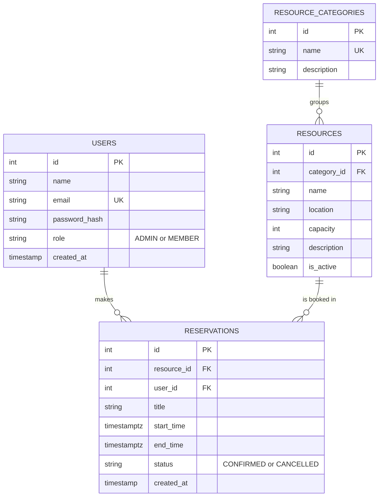

# Resource Reservation Management System

A full-stack web application that lets an organization manage its shared resources (meeting rooms, equipment, vehicles, workspaces) and reserve them **without double-booking**.

Built with **Next.js (App Router)**, **TypeScript** and **PostgreSQL** for the PrimeWave Lab Software Engineering Internship technical assessment.

## The problem

The organization coordinates shared resources through informal messages and manual records, which causes overlapping reservations and uncertainty about availability. This system gives them one place to see what exists, what is free right now, and to book it reliably as usage grows.

## Features

**For every user**
- Sign in with email and password (roles: Admin and Member)
- Browse resources by category, with a live "Available now / In use now" status
- Resource page with upcoming bookings and a booking form
- Clear conflict messages, for example "Already booked Wed 14 Oct, 10:00-12:00"
- "My reservations": upcoming bookings (cancel any time) and history
- Cancel your own bookings

**For admins**
- Add, edit, deactivate and reactivate resources
- Deactivation is blocked while a resource still has upcoming bookings
- Cancel any booking
- Usage overview: bookings and hours per resource, today's bookings, unused resources

## Key engineering decisions

| Decision | Why |
|---|---|
| **Overlap prevention enforced inside PostgreSQL** (`EXCLUDE USING gist` on resource + time range, via `btree_gist`) | An application-only check can fail when two people click "Book" at the same instant. The database makes a double-booking impossible. The app also pre-checks to give a friendly message. |
| Half-open time ranges `[start, end)` | A booking ending at 12:00 and another starting at 12:00 do not conflict. |
| Constraint applies only to `CONFIRMED` bookings | Cancelling frees the slot immediately, while history is kept. |
| Soft cancel and soft deactivate (no deletes) | Usage history and reports stay accurate. |
| `timestamptz` columns and a fixed organization time zone (Asia/Colombo) | Everyone sees the same times regardless of their browser's time zone. |
| Authorization checked on the server in every page and action | Hiding a button is not security. Role is re-read from the database on each request. |
| Passwords hashed with bcrypt; sessions are signed, HTTP-only cookies (JWT via `jose`) | No plain-text passwords, no client-readable session token. |
| Server-side validation of every field | Title, 15 min to 8 h duration, no past bookings, max 90 days ahead, active resources only. |
| Prisma 7 with the PostgreSQL driver adapter | Typed queries and tracked migrations. The overlap rule is added as hand-written SQL in the first migration. |
| Next.js Cache Components disabled | Every page is per-user and must show live availability, so ahead-of-time prerendering adds no value. |

## Data model
**ER diagram (shareable link):** [View the ER diagram](https://drive.google.com/file/d/19SGQrRI9D5k4E8TtObPZ9R0GVkw0nXzN/view?usp=sharing)


Database-level rules on `reservations`: `end_time > start_time` (CHECK), and no two `CONFIRMED` rows for the same resource may overlap (EXCLUDE constraint).

## Getting started

**Prerequisites:** Node.js 20.9 or newer, Docker Desktop, Git.

```bash
# 1. Clone and install
git clone https://github.com/chamodyashakunthala/resource-reservation-system.git
cd resource-reservation-system
npm install

# 2. Create your environment file
cp .env.example .env            # Windows PowerShell: Copy-Item .env.example .env

# 3. Generate a session secret and paste it into SESSION_SECRET in .env
node -e "console.log(require('crypto').randomBytes(32).toString('hex'))"

# 4. Start PostgreSQL (runs on localhost:5433)
docker compose up -d

# 5. Create the tables (including the no-overlap constraint) and the Prisma client
npx prisma migrate deploy
npx prisma generate

# 6. Load sample data
npm run db:seed

# 7. Run the app
npm run dev
```

Open http://localhost:3000.

### Demo accounts

| Role | Email | Password |
|---|---|---|
| Admin | admin@company.test | Admin@123 |
| Member | nimal@company.test | Member@123 |
| Member | sara@company.test | Member@123 |

The seed data is a software company with 10 resources in 4 categories (meeting rooms, equipment, vehicles, workspaces) and a few bookings for tomorrow and the day after. Re-running `npm run db:seed` resets the data.

## Try the double-booking protection

1. Sign in and open the **Boardroom**. The seed books it tomorrow 10:00-12:00.
2. Book tomorrow **11:00-13:00**: rejected with a message naming the clashing booking.
3. Book tomorrow **12:00-14:00**: accepted, because it touches but does not overlap.
4. Cancel a booking, then book the same slot again: accepted.

To see the database rule itself:

```bash
docker exec -it reservation-db psql -U app -d reservations -c "\d reservations"
```

## Project structure

```
src/
  app/
    login/                  sign-in page and server actions
    (app)/                  everything behind login
      page.tsx              resource list with category filters
      resources/[id]/       resource detail, booking form, cancel action
      reservations/         "My reservations"
      admin/resources/      manage resources (admin only)
      admin/usage/          usage overview (admin only)
  components/NavBar.tsx
  lib/                      database client, session, auth guards, time helpers
prisma/
  schema.prisma
  migrations/               includes the hand-written no-overlap constraint
  seed.ts
```

## Known limitations and next steps

- Users are created by the seed script; there is no sign-up or user-management screen yet.
- No email notifications, recurring bookings or calendar grid view.
- No business-hours rules per resource and no rate limiting on login.
- No automated test suite yet. Behaviour was verified manually, and `tsc`, `eslint` and a production build run clean.
- The time zone is fixed to Asia/Colombo (a multi-site organization would store a zone per resource).